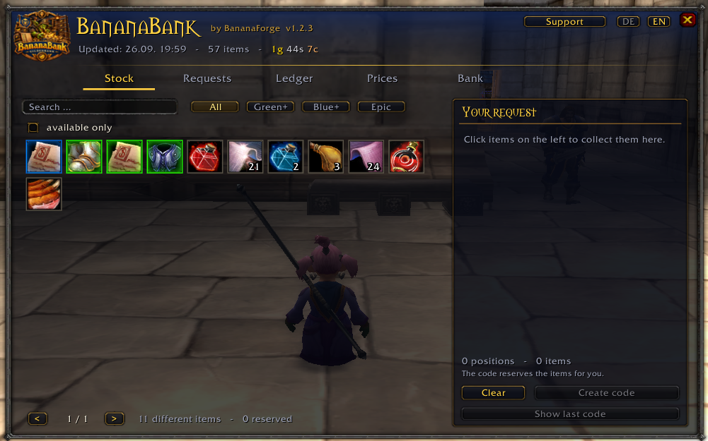
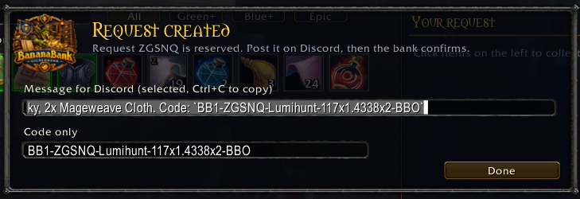
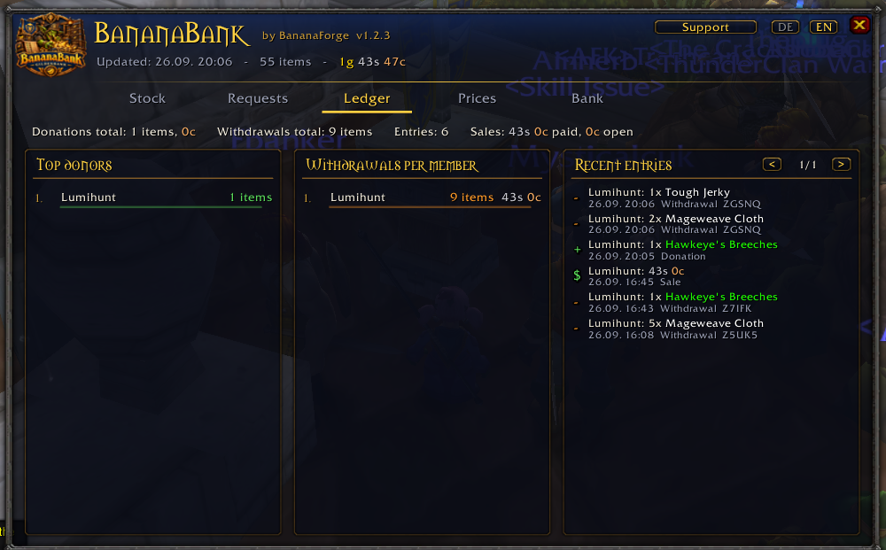
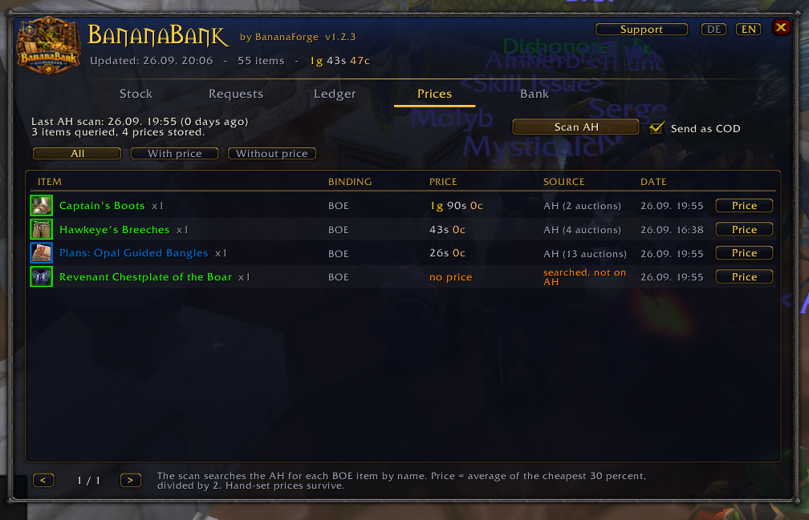

# 🍌 BananaBank

**Guild bank for Vanilla WoW 1.12 (OctoWoW): share your stock, request items, track donations.**

  

Vanilla WoW has no guild bank, so nobody knows what the bank character holds or who donated what. BananaBank fixes that: the bank character shares its stock over the guild channel, members request items with a code, the bank mails them out, and every donation and withdrawal lands in a ledger. Built for the guild **Banana Republic**. Lua 5.0, no libraries.

## Requirement: the guild rank `Gildenbank`

BananaBank only works in a guild that has a guild rank called **`Gildenbank`** (`guildbank` works as well, case does not matter). Only characters holding that rank count as a verified bank.

- The rank names are fixed in the addon. There is no setting for another rank.
- Without a character holding the rank, the addon is locked and the window only shows a notice.
- Every member checks the rank in their own guild roster, so editing files does not get around it.

## Features

- **Stock for everyone:** the bank character records bags and bank on every bank visit. Grid with quality borders, search and filters. Soulbound items are hidden.
- **Requests by code:** fill the cart, create a code, post it on Discord. The code reserves the items right away. Status: `Open → Confirmed → Sent`. Open requests expire after 7 days.
- **Mail and trade:** *Fetch items* prepares exact stacks, the send helper mails them (several attachments if the client allows). A trade with a requester counts towards their confirmed request.
- **Prices and COD:** targeted auction house scan for BOE items (average of the cheapest 30 %, divided by 2). Prices can be set by hand. Mail goes out cash on delivery if you want.
- **Ledger:** donations by mail and trade, withdrawals, COD sales and returned mail are booked automatically. Click a member in *Top donors* or *Withdrawals per member* to open a window with every stack (item, amount, date, source) in a scrollable list, switchable to totals per item. The **Totals** window shows how much of each material the whole guild donated or took, with search and top donors per material. Transfers between bank characters are not donations.
- **Bank directory (visible on bank characters only):** every bank character sets its own role (short role, description, categories such as cloth, leather, herbs, ore, potions, bags, recipes, BoE gear). The **Banks** tab lists all active banks with contents, gold, last scan and online state. The stock can be shown for all banks together or for a single bank (button next to *only available*). Item tooltips say which bank an item belongs to and when it lies on the wrong one. The Bank tab shows where the rest of a request is stored.
- **Guild quests:** officers post farm quests ("60 Runecloth for bags", several items per quest, optional deadline). Progress is counted from the ledger whenever the bank character accepts a delivery by mail or trade. Top helpers per quest, a permanent points ranking, a tracker window and a toast when a quest is complete. Delivered items can be locked for requests. Each quest has its own **icon** (picked from the game's macro icon list, default = icon of the first item) and an own **tooltip text**; quest items show the normal item tooltip, **Shift-click** puts an item link (or the quest title) into the chat or the open quest editor, **Ctrl-click** takes an item over into a new quest. Completing a quest offers **post again with a new name** (#2, #3 ...), closed quests have a **Repeat** button, and officers can **post a quest to guild chat** (title plus real item links).
- German and English, minimap button, `/bb status` diagnostics.

## Screenshots

| Stock | Request code | Ledger | Prices |
|---|---|---|---|
|  |  |  |  |

## Installation

1. Download the [latest release](https://github.com/BananaForge/BananaBank/releases) and put the `BananaBank` folder into `Interface/AddOns/`.
2. Enable it on the character screen and open the window with `/bb`.

When updating, delete the old folder first, otherwise an old `BananaBank.toc` can stop the new files from loading. **Every member needs the addon.**

## Usage

**Setup (once):** the guild master creates the rank `Gildenbank` and gives it to the bank character. On that character run `/bb setbank`, then open the bank.

**Members:** open `/bb`, click items on the **Stock** tab (click `+1`, Shift+click all, right-click `-1`), hit **Create code**, copy the message to Discord, follow the status on **Requests**.

**Bank character:** on the **Bank** tab paste the code, **Check**, then **Confirm** or **Reject**. At the bank hit **Fetch items**, at the mailbox **Send mail**.

| Command | Effect |
|---|---|
| `/bb` | Open or close the window |
| `/bb status` | Diagnostics: why is nothing shown? |
| `/bb setbank` / `removebank` | Set or remove the bank role for this character |
| `/bb scan` / `sync` | Record and send stock / sync with the guild |
| `/bb prices` / `ahscan` | Prices tab / fetch prices at the auction house |
| `/bb ledger [n\|text\|today]` | Print the latest ledger entries in chat (to check what was booked) |
| `/bb credit` | (bank character) credit donations that were booked without a quest to the open quests |
| `/bb book <player> <count> <item>` | (bank character) book a donation by hand |
| `/bb stock <text>` | (any character) show which stored bank stocks contain an item, with age and sender |
| `/bb find <text>` | (bank character) show where matching items are, and which bags are in use |
| `/bb maillog [N]` | (bank character) the last mail takes and why something was not booked |
| `/bb abgleich [rezepte]` / `abgleich buchen <Spieler> <Nr>` | (bank character) items in stock without a ledger entry, and book them afterwards |
| `/bb banks` | Open the Banks tab |
| `/bb totals` | Open the donation totals window |
| `/bb quests` / `tracker` | Open the Guild quests tab / show or hide the quest tracker |
| `/bb unhide` | Show hidden items again (Alt+click hides an item) |
| `/bb lang de\|en\|auto` | Language |
| `/bb minimap` / `support` / `debug` | Minimap button / donation window / debug output |

A second bank character works the same way: any character with the rank can run `/bb setbank`. Stocks are added up, and a request can be filled from both.

## Guild quests

- **Who may create and manage quests:** guild master (rank 1), the `Gildenbank` rank and the officers (ranks 2 and 3). Everybody else sees quests and progress.
- **Creating:** *Guild quests* tab, **+ New quest**. Add items with Shift-click on an item in your bags (or Ctrl-click in the stock), set amounts, optional deadline in days, and whether delivered items are locked for requests.
- **Delivering:** by mail or trade to a bank character. A delivery counts when the bank accepts it. Overflow beyond the need is booked as a normal donation, older quests are filled first.
- **Points:** your share of each quest, added up (a whole quest alone = 10 points). Ranking is permanent, with a monthly view.
- **Tracker:** *Track* on a quest puts it into a small movable window. `/bb tracker` hides or shows it.
- Only deliveries booked by a verified bank character count, other clients discard anything else.
- Quest managers' activity is kept in a hidden local log for officers.

## Technical notes

- Client 1.12.1 (Interface 11200), saved variables `BananaBankDB`, addon prefix `BBNK` on the guild channel.
- Analytics: once per login, and when the guild dashboard BananaGuild asks for it, the addon reports its name and version invisibly to the guild (guild addon channel, prefix `BGLD`, via `BananaPresence.lua`). Nothing is shown in chat.
- Throttled send queue (0.3 s), messages under 250 bytes. Synchronised: stock, ledger, requests, prices, guild quests.
- Code format: `BB1-<ID>-<Player>-<ItemID>x<Amount>.<...>-<Checksum>` (Base36, DJB2 checksum).
- Limits: stock can only be read while the bank is open (the last scan is used in between). Other mail addons such as TurtleMail can interfere with attachments. Someone editing their own files can only fool themselves: other clients discard the data, and mail only goes to the name in the code.

## Contributing

Pull requests welcome, tested in-game on a 1.12 client. Lua 5.0 rules: no `#`, `%`, `string.match`, `select` or `...`; script handlers read `this`, `event` and `arg1..9` as globals; no `SetSize` or `SetColorTexture`; German texts in `Locale.lua` use umlauts and `ss` instead of `ß`.

## Changelog

- **3.6.9:** Totals window: searching a donor name (start of the name) lists every item that person donated with their own amounts, not the guild totals; the last column shows the donor.
- **3.6.8:** ledger: the Totals button sits at the bottom of the recent-entries panel, the ledger search box is gone; the Totals window searches items and donor names.
- **3.6.7:** stock tab: icon view removed (list only), the "only available" and "Trash only" chips sit in the top row right-aligned with the list, the second toolbar row is gone so tree, list and request panel start higher.
- **3.6.6:** stock tab: the request panel starts level with the list (5 rows, buttons moved down now that the code button is gone). Ledger: recent entries panel starts level with the two top lists, the tile strip spans the full width again.
- **3.6.5:** layout fixes: ledger tiles no longer run under the recent-entries panel (Totals button moved next to the search), price tab info/legend shortened and column heads right-aligned over the values, stock view chips stay in the top row.
- **3.6.4:** request code switched off (flag `BB.USE_CODE` in Core.lua, easy to re-enable): the cart button is now "Send request", no export window, no "last code", no redeem box in the bank view, no Code button in the request list; help texts updated.
- **3.6.3:** Guild quests tab: progress text sits inside the bar (left), wider bars with a fixed "left/done" column, finished goals are sorted below open ones, the four action buttons are equally sized (Edit neutral, Close green, Cancel red) on the action row.
- **3.6.2:** Prices tab: one toolbar (filters, scan info, scan button, COD checkbox), right-aligned price/source/date columns with the price in bold, "Edit" button, single-line legend; vendor-priced items are no longer listed.
- **3.6.1:** Ledger tab: figures as tiles (donations, withdrawals, COD paid/open, entries), top lists with separate columns for items and gold, entries with the date on the right and a coloured kind mark.
- **3.6.0:** readability: panels and the main window are opaque now (no world text shining through). Banks tab is a real table (column heads Bank / Role / Items / Gold / Last scan, zebra rows, description under the name).
- **3.5.1:** stock tab: list view is the default; "only available" and "Trash only" are chips on one baseline (like the quality chips), view chips sit flush right with the list, the bank selector menu is gone (single bank: Banks > Show content, then a "Bank: X x" chip resets it).
- **3.5.0:** at the very first opening of BananaBank (once per account) the addon asks the server for all stock items the client does not know yet (throttled, 4 per second, progress bar with cancel), so names, colors and tooltips are complete. Only item ids from verified bank chars and in a sane range are queried. `/bb items` repeats it by hand.
- **3.4.2:** hotfix: the stock slots (and the bag/bank slots on bank chars) registered for clicks with "AnyUp", which the 1.12 client does not know, so left clicks did nothing. Now registered explicitly for left, right and middle button.
- **3.4.1:** new `/bb why [item name]` request diagnosis (rank, rules, price, class, availability); click registration of the stock slots falls back to left/right click if needed.
- **3.4.0:** **Trash manually**: press the mouse wheel on an item (stock list, bags, bank slots) to flip trash / not trash; flipping back to the automatic result drops the exception. Manual decisions are shared between all bank chars (guild channel, newer entry wins, only from verified bank chars) and listed under Settings > Trash exceptions with "Reset all". Items that cannot be sold are set to "not trash" automatically. The ledger books what the vendor really paid ("Trash income"). **Price fix:** the 50 silver minimum applies only to BOE, recipes and bags; all other items cost vendor value +25 % exactly.
- **3.3.3:** fix: the class restriction read at the bank scan never made it into the synced snapshot, so class items (e.g. Tome of Arcane Brilliance) could be requested by any class. The bank char now keeps it in the snapshot and re-sends when it changes. Bank chars must open the bank once with this version.
- **3.3.2:** a missing new file (old file list after a plain /reload) no longer causes Lua errors in the settings; the file check now also names VendorData.lua, Vendor.lua, UI_Lotse.lua and UI_Trash.lua.
- **3.3.1:** trash is now **grey items plus everything under 2 silver** vendor value (limit adjustable in the bank settings, default 2s). Grey items count as trash whatever the vendor pays; quest items and keys never do.
- **3.3.0:** (new files VendorData.lua, Vendor.lua, UI_Trash.lua: restart WoW fully) **Vendor prices:** every item except BOEs, recipes and bags is priced at vendor value +25 % (min. 50 silver, vendor data from ShaguTweaks, MIT); items without a known value cannot be requested. **Trash** (bank chars only): items under 10 silver vendor value (setting) are marked in the stock list (tint, coin, filter "Trash only"), in bags/bank slots and in tooltips; at a vendor a window offers preview and "Sell trash" (reserved and quest items stay, Ctrl-click an item to never sell it); "Fetch trash" at the bank; income is booked as "Trash income". **Class items** ("Classes: Druid") can only be requested by those classes (read from the tooltip at the bank scan, synced). **Ledger search** by name.
- **3.2.2:** NPC senders (every auction house, postmasters, game masters) are no longer donors: not booked from the mailbox, and existing entries are ignored in the top donors, summaries, quest progress and ranking.
- **3.2.1:** bank pilot: texts fit their buttons (wider view button, wider main button in the small view, shorter one-line texts), header no longer overlaps.
- **3.2.0:** **Bank pilot** (new file UI_Lotse.lua, restart WoW fully): a small window that guides a bank char through a request: 1 Check (accept as crafter / confirm / reject, COD shown), 2 Fetch (items from the bank, automatic once the bank window is open), 3 Send (letter n/m with the expected COD next to the value in the send window, live), 4 Done (next request). Opens when the first request is opened in the big window, which then steps aside. View switch in the header: Normal / Small (one line) / List of requests. Requests whose items sit on another bank char are queued last, and the pilot names the bank to switch to.
- **3.1.13:** layout: stock tree is narrower so the result list is wider and the scrollbar no longer covers the prices; quest goal rows have a shorter bar and a wider status column so "done"/remaining text no longer overlaps.
- **3.1.12:** ledger: hovering received donations (and gold entries) now shows a tooltip too; if the item id is not known yet it is looked up by name, otherwise a simple tooltip (name, amount, donor, date) is shown.
- **3.1.11:** fix: gold donations for quests were discarded by other clients as "forged" (only item bookings were accepted). Gold bookings from verified bank chars now count everywhere; everyone needs this version to see the progress.
- **3.1.10:** ledger: gold donations to a quest show the receiving bank char ("17s > Bananenweed") and a shortened quest title so the second line no longer wraps.
- **3.1.9:** quest detail: the scrollbar sits inside the panel, right of the rows. Bank chars now print a chat line when gold from the mailbox is booked ("Gold from X booked: ..."), and a char with the bank rank that is not in bank mode warns once when it empties a letter (nothing is booked there).
- **3.1.8:** quest detail: item and gold-goal rows now have a scrollbar (no more overlap with "Best helpers"). Banks may store whatever they want: the role-vs-category plausibility is gone (no "misplaced items" warning, no category picker in the role editor, no stock tooltip hints); the Banks list shows the description instead.
- **3.1.7:** Banks tab: bigger summary header (banks / items / gold), taller bank rows with three lines, and the "misplaced items" warning is spelled out and lists the items in the tooltip.
- **3.1.6:** fix: the quantity columns in the bank view were placed outside the visible area. They are back, written out (REQUESTED / SENT / HERE), with the item name taking the rest of the width; request list columns re-spaced as well.
- **3.1.5:** guild crafter claim covers exactly **one copy** of a recipe (a second copy in the same request is paid at the normal price, in the basket price, the request COD and the mail). Bank view: the [G]/[frei] tag now sits in front of the item name, the quantity columns moved to the far right so names are readable, and the "Bank character" box is collapsed into a button that drops down over the table.
- **3.1.4:** Requests list: the whole row is clickable (bank: opens the request; members: shows the code), the "Open" button is gone, columns re-spaced so the cash on delivery is fully readable.
- **3.1.3:** the bank view shows the cash on delivery of the request right away, before confirming (with a pending guild crafter claim: "now > after accepting").
- **3.1.2:** cash on delivery is now visible before sending: the **Requests** list has a new COD column (for a pending guild crafter claim: "now > after accepting"), and the **mailbox helper** shows the COD of the next letter, the value currently entered in the send window (green "matches" / red "differs!", updated live) and the request total.
- **3.1.1:** guild crafter claim is now **automatic**: every recipe in the basket that your own client finds eligible (keyword, scanned profession, not known yet, skill) is claimed without clicking; the G button only opts a recipe out/in again. A recipe whose required skill the client cannot read (item never seen) is no longer blocked.
- **3.1.0:** guild quests can have **gold goals**: in the quest editor, "Gold goals (n)..." lets you pick bank characters and an amount of gold for each (e.g. 6 chars x 5g). Members just send gold by mail to those chars; progress is booked as soon as the bank char takes the gold from the mailbox (no code needed) and shown as one bar per char. Surplus above a char's goal is booked as a normal gold donation. Items and gold goals together are limited to 6 per quest. Banks tab: line layout fixed.
- **3.0.6:** the "Bank" tab is gone from the tab bar. The bank view (redeem code, open request, bank tools) now opens over **Requests** when a request is opened, or any time via the new button "Bank view / redeem code" on the Requests tab; "< Back to requests" returns. The **Banks** tab is now a compact list: 2 lines per bank (name, role, items, gold / categories, misplaced items, scan, online); the description is shown as a tooltip.
- **3.0.5:** settings: an open selection menu (rank, depot type/char, keyword profession) is now closed when switching tabs or closing the window and covers the whole screen while open, so it can no longer carry over into other tabs. Without a selection the previous value stays unchanged.
- **3.0.4:** guild crafter flow as agreed: only recipes the **player's own client claimed** (G button in the basket) can be accepted by the bank; the automatic "possible" marking by keyword is gone. The bank tab shows the claim directly under the item rows with the cash on delivery **now and after accepting** (e.g. 4 recipes at 50 silver: 2g now, 1g 50s after accepting one), the claimed recipe is tagged [G], accepted ones [frei]. The overlapping layout is fixed.
- **3.0.3:** the bank also offers *Accept as guild crafter* when the player sent no claim (older client): recipes that fit keyword, profession and the ledger are marked `[guild crafter possible]`. New diagnostics: `/bb rights [name]` (keyword table, officer note keywords, rights list, effective keywords of a player) and `/bb craft [text]` (why a recipe can or cannot be requested for free on this character).
- **3.0.2:** the missing-file message now also says that /reload does not re-read BananaBank.toc: after an update with new files, quit WoW completely and start it again.
- **3.0.1:** if `Rules.lua` or `Craft.lua` are missing (incomplete update), the addon no longer throws errors; the file check names the missing file.
- **3.0.0:** **guild crafters and keywords** (step 4). New *Keywords* tab in the settings (Gildenbank rank): keyword and profession (or bags) pairs for the officer note, e.g. `[B, GSN, GE]`. Bank characters with the officer-note permission read the keywords and send a keyword list to the guild so every client knows its own rights. **Bags** can only be requested with the bags keyword. **Guild crafter:** a recipe whose profession fits one of your keywords gets a **G** button in the basket (only when your own client confirms: profession window scanned once, recipe not learned yet, skill high enough). The request is marked *guild crafter*; the bank sees *Accept as guild crafter* (checks rank, quality, keyword, profession of the recipe, and that the player has not received the recipe before according to the ledger; then the price of that recipe is 0, the rest stays normal), *Confirm normally* or *Reject*. Items from depot characters can no longer be requested (checked by the bank as well). A second short hello message (`X~`) now carries the rule / main bank / keyword list stamps.
- **2.9.1:** fix: depot type names typed in the settings were lost (the edit field changed the wrong row because of a Lua 5.0 loop variable), the same for removing rows and the type / character menus of the depot rows.
- **2.9.0:** depot types are editable. New **Depots** tab in the settings: up to 6 freely named types (default: Welcome packages, Raid stuff; rename, add with + Type, delete with x), every type shows up in the stock tree under "View only". Below, up to 4 depot characters: the type on the left, the character on the right (menus). The types are part of the synced rule set.
- **2.8.1:** depot characters are chosen from a menu of the known bank characters instead of typed in; each row has a character menu, a kind menu (welcome packages / raid stuff) and an x; **+ Depot** adds a row (up to 4, several characters per kind are merged).
- **2.8.0:** **depot characters** (step 3). In the Rules tab a Gildenbank character names one character for *Welcome packages* and one for *Raid stuff*. Their stock is left out of "Entire bank" and shown only in two new entries under "View only" in the category tree; items there cannot be requested (also not when such a character is picked in the bank selector). The depot names are part of the synced rule set.
- **2.7.2:** items that had no price at the last scan (not found at the AH) are always scanned again, regardless of the age setting.
- **2.7.1:** faster AH scan: items without any price scan come first, then the oldest scans; only prices older than N days are fetched again (setting for bank characters, default 10, 0 = scan everything). Hand-set prices are never fetched.
- **2.7.0:** guild prices: the calculated guild price (half of the cheapest 30 percent at the AH) is at least **50 silver**; older AH-based prices are raised to 50 silver as well, hand-set prices are left alone. **Bags** are now priced by the AH scan like BOE items and recipes (bind column shows "Bag", the price shows in the tooltip and goes into the cash on delivery).
- **2.6.0:** **request rules** (step 1 of the officer meeting list). New *Rules* tab in the settings: a character with the Gildenbank rank sets from which rank requests are allowed at all, and from which rank green, blue and epic items may be requested. Saved rules are synced to the guild (only accepted from a verified bank character; the newer set wins). **Until rules are saved, all requests are locked.** Members below the rank see the stock but cannot fill the basket or create a code; items above their quality are dimmed with a tooltip hint. The bank checks rank and quality again when it confirms a request (old or modified clients cannot bypass it), an unknown rank (not in the guild roster yet) counts as locked. Ranks are stored by name and position, a renamed rank is shown in the rules tab. Bank characters are exempt.
- **2.5.0:** **TurtleMail support**: with TurtleMail installed the attachments live in its own list (invisible to `GetSendMailItem`) and its Send button sends them. The addon now checks attachments with `TurtleMail.sendmail_attached` and sends through `TurtleMail.send_mail_button_onclick` (recipient set past its `SetText` override), instead of the standard send function, which sent letters without attachment and was rejected by the server for small characters.
- **2.4.5:** mail sending: when the mail window takes the item from the cursor but does not answer `GetSendMailItem`, an empty cursor after the click now counts as attached (the letter is sent). The failure message also prints the raw answers of `GetSendMailItem`. If the server still rejects the letter nothing is lost.
- **2.4.4:** mail sending: one single click per attachment (the second click attached items twice in the multi-attachment mail window), the result is checked after half a second, then the right-click way is tried once. A letter is never sent without a confirmed attachment.
- **2.4.3:** mail sending now goes through the mail window's own Send function like a manual send (cash on delivery in the amount field, COD mode selected), so a replacement mail window / mail addon handles it. The direct `SendMail` call remains as fallback.
- **2.4.2:** mail sending: when the client reports the attachment a moment late (multi-attachment mail window), the addon waits half a second and checks again instead of aborting with "The client did not take the attachment".
- **2.4.1:** mail sending: if the client does not take an attachment by the cursor, a second way (right-click attach, only while the Send tab is open) is tried and checked with `GetSendMailItem`. On failure the window state is printed, also `/bb maildebug`. The attachment slot count is no longer cached before the mail window exists.
- **2.4.0:** **bank mode is automatic** for every character with the Gildenbank rank (set at login; switch in the settings; whoever ran `/bb removebank` stays off). New **stock / ledger check**: `/bb abgleich [rezepte]` lists items that are in the bank without the ledger knowing them as received, `/bb abgleich buchen <player> <1,3,5-9|alle>` books them afterwards as a donation of that player (quests are credited as usual).
- **2.3.2:** opening the mailbox on a bank character refreshes the guild roster first, so new members are known. Mail from senders who are not in the guild roster is still booked, but marked: "(not in guild)" in the ledger and a note in the mail log.
- **2.3.1:** **mail log** for bank characters (`/bb maillog [N]` or Settings > Mail log): every mail take is logged with the reason when it was not booked (cash on delivery, sender is a bank, no room in the bags, no attachment, duplicate call). Duplicate detection is now based on the mailbox update event instead of a timer, so a pile of identical mails taken quickly is booked completely.
- **2.3.0:** category tree by profession: Entire bank, **Professions** (every profession selectable: alchemy, blacksmithing, enchanting, engineering, leatherworking, tailoring, jewelcrafting, cooking, first aid, other), each with its trade materials and its recipes (herbs under alchemy, ore under blacksmithing, leather under leatherworking, cloth under tailoring), then BOE (by slot), Potions, Bags, Other. Results are grouped the same way, e.g. "Alchemy - Recipes". Jewelcrafting recipes are recognised.
- **2.2.2:** category tree reordered: Entire bank, Trade materials, BOE, Recipes, Potions, Bags, Other (the results follow the same order). "Sellable" removed from the filter.
- **2.2.1:** cloth, leather and ore are recognised by the item name ending even when the server reports the same sub type for all trade goods (they were listed under trade goods / other). Category renamed to **Trade goods** (German: Handwerkswaren).
- **2.2.0:** the category tree gets a **All materials** group with sub-categories: cloth, leather, herbs, ore, and trade materials by profession (alchemy, enchanting, engineering, blacksmithing, jewelcrafting, tailoring, cooking, other). Results are grouped the same way, e.g. "Trade materials - Jewelcrafting". Banks scan the profession once more; until then it is derived from the item info or the name.
- **2.1.1:** sorting fix: items from old snapshots without a category are now sorted by their real type on every client (cloth, leather, ore, potions by item info or name), new category **Trade materials** for gems, thread, essences and similar, so "Other" only holds what really does not fit. The type name "Sellable" is shorter.
- **2.1.0:** stock tab in auction-house style: category tree on the left (recipes by profession, BOE by slot, cloth, leather, herbs, ore, potions, bags, other), results grouped under category headings (empty search = whole bank, sorted by category, then quality and name), icons at 24 px, scrolling instead of pages, switchable **list view** with names, counts and guild price. The type drop-down is replaced by the tree. Items from old snapshots without a category are listed under "Other" until the bank scans again.
- **2.0.0:** **settings window** (gear button, top right) replaces most slash commands: language, minimap button, quest tracker, debug, unhide items, status; for quest managers the quest log and quest credit; for bank characters bank mode, cash on delivery, whisper, scan, sync, AH scan and booking by hand. Sections that do not apply to the character are hidden. New **main bank**: the name members should send donations and mail to is shown at the top right ("Donate to: Bananenbank", click puts it into chat) and used in the guide and the quest hint. Guild master, Gildenbank rank and officers set it in the settings, the guild syncs it (only from managers). The guide no longer opens by itself. Slash commands keep working.
- **1.9.0:** built-in guide as a slideshow: the new **?** button (top right) or `/bb guide` opens 7 steps for members (stock, requests, pick-up, donating, guild quests, prices) and 5 steps for bank and officers (bank mode, handling requests, booking donations, creating quests, paying out). Screenshots can be added per slide later.
- **1.8.0:** guild quests get an **icon** (macro icon picker, default = first item) and a custom **tooltip text** (shown on the icon in the list, the detail view and the tracker, followed by need and progress). **Complete and post again:** closing a quest opens a dialog (only complete, or complete and post again with a new name, duration and reservation); closed and cancelled quests have a **Repeat** button. **Post to guild chat** sends the quest as text with real item links (officers only). Quest items now show the normal item tooltip everywhere; **Shift-click** an item (or the quest title) to put it into the chat, or into the open quest editor; **Ctrl-click** an item to take it over into a new quest; **Shift-click an item link in the chat** adds it to the open editor. Icon and tooltip are synced with the guild; older versions ignore the new fields.
- **1.7.0:** every BOE item and every recipe/formula counts as sellable (prices tab lists them all, bind column shows "Recipe"). New type filter in the stock tab for everyone: all recipes or one profession (e.g. Alchemy), BOE by slot, "Sellable", materials. A completed quest has a new **Pay out** button: it sets the delivered amounts aside as a confirmed request for a recipient (e.g. your tailor) and closes the quest, so the quest reservation ends and nothing stays reserved twice; mail it from the Bank tab. Banks must scan once so older snapshots get types.
- **1.6.6:** mail that stacks onto a partial stack is booked also when the bags are full (before, it was missed). New `/bb ledger`, `/bb credit` (credit unassigned donations to open quests, as separate "Quest credit" entries) and `/bb book` (book a donation by hand).
- **1.6.5:** a character holding the Gildenbank rank without bank mode gets a hint at login (its stock would otherwise go stale unnoticed); `/bb setbank` scans and sends the stock right away.
- **1.6.4:** new `/bb stock <text>` diagnostic for any character: which stored bank stocks contain an item, when they were stored and who sent them.
- **1.6.3:** equipping or swapping bags (bag slots and bank bag slots) refreshes the bank stock, so bags in use no longer count as available. New `/bb find <text>` shows where a bank character holds an item.
- **1.6.2:** the bank stock updates on every change of the bags, also with the bank closed (mailing, trading, opening the bags), but is only sent when the content changed. Fixes items showing up twice after being mailed from one bank to another.
- **1.6.1:** the bank directory (Banks tab, bank selector, belongs-to hints) is only shown on characters in bank mode.
- **1.6.0:** bank directory with roles and categories, banks tab, stock per bank, "belongs to" hints in tooltips, remaining items of a request shown with the bank that holds them. Stock snapshots carry the item category (set by the bank character).
- **1.5.0:** clickable ledger members (stack-by-stack window with item tooltips, scrollable, totals per item) and a guild-wide totals window per material. Split deliveries are shown as one stack again.
- **1.4.0:** guild quests (several items, optional deadline, top helpers, points ranking, tracker, toast, item reservation, hidden manager log). Ledger entries that advance a quest are only accepted from verified bank characters.
- **1.3.0:** fixed bank rank `Gildenbank` / `guildbank` as a hard requirement (lock screen, no rank setting), trades count towards confirmed requests, COD price frozen per stack, returned mail reduces withdrawals, bank-to-bank transfers are no longer donations.
- **1.2.x:** AH scan per item, price dialog, COD, rank sync (removed in 1.3.0).
- **1.0.0:** first release.

## Credits and license

Part of **BananaForge** (with [BananaRepublicProfs](https://github.com/BananaForge/BananaRepublicProfs) and [BananaLootline](https://github.com/BananaForge/BananaLootline)). Development: **Lumihunt**, guild Banana Republic. Free forever; if you want to support it, send in-game mail to Lumihunt. MIT, see [LICENSE](LICENSE).
